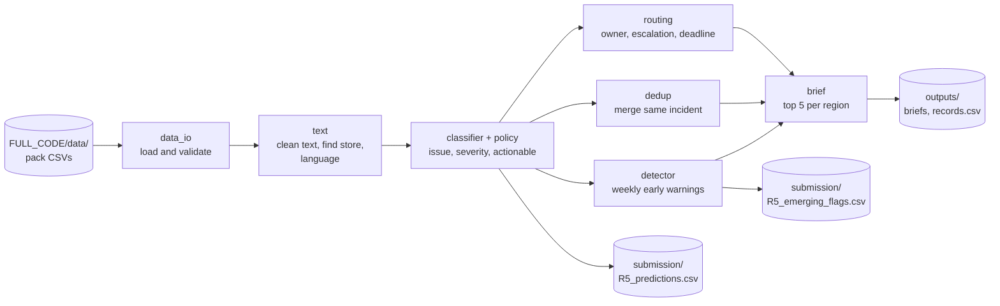
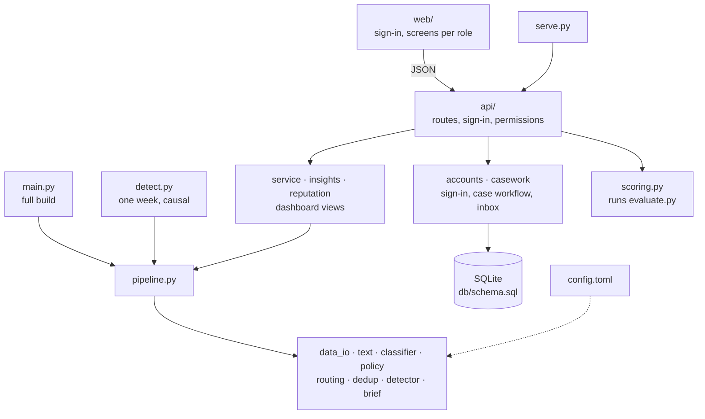
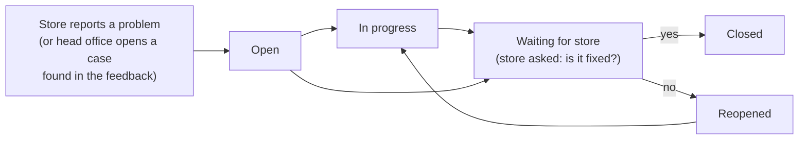
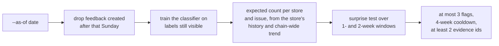

# 1213 · R5: Voice-of-Store Engine

Turns 40k messy, multilingual store-feedback records into a routed, prioritised weekly action list per region,
and flags store-level problems while they are still small.

## What it does

### Problem statement (R5)

Saffron Retail, a grocery chain with 60 stores in five regions of India, receives about 1,500 feedback
messages a week: online reviews, app comments, staff shift notes and call-centre transcripts. They are in
English, Hinglish, transliterated Tamil and Marathi, with typos, emojis and shorthand. Real store problems
(a broken freezer, a mislabelled allergen, a rude billing counter) are buried in this noise and reach head
office weeks late.

The task is to turn this feedback into a prioritised weekly action list routed to the right owner:

* label every message with an issue type, a severity and whether someone can act on it;
* route each issue to its owning team with a severity and a stated escalation rule;
* flag an issue that is small in volume but rising sharply at one store, before it shows up chain-wide,
  using only feedback up to that week's Sunday and citing at least two messages as evidence;
* write a one-page brief per region each week: top 5 issues, evidence quotes, affected stores and a trend
  arrow against last week;
* report a score from the organisers' `evaluate.py` and a precision statement (of the issues escalated, how
  many were truly actionable).

The data has 39,769 messages over 26 weeks, with labels for 3,000 messages from the first 13 weeks.

### What the engine does

1. **Classifies** every record: issue type (IT01–IT30, NI01–NI03), severity (low to critical) and actionable (0/1).
2. **Routes** every actionable record to its owning team with an escalation level and deadline.
3. **Detects emerging issues** week by week, using only feedback up to that week's Sunday.
4. **De-duplicates** the same incident reported through several channels (stretch goal).
5. **Writes a one-page brief per region per week**: top 5 issues, owner, severity, quotes, stores, trend arrow.

**Users** sign in to the web app with one of two roles:

* **Head office** sees every store: the week's numbers, a store board (one bubble per store, sized by cases
  and showing its biggest problem; or a map), stores doing well, early warnings, the regional brief, every
  case with filters, and the model's score. It works each case through to a fix.
* **Store managers** (three demo stores) see only their own store: what to do this week with deadlines,
  early warnings, reputation and the last problem solved. They report problems from staff notes; the model
  labels and routes them to head office. When head office marks a problem solved, the store is asked to
  confirm it is fixed; "no" reopens it.

### Results

| | This engine | Pack baseline |
|---|---|---|
| Classification, 5-fold cross-validated | **0.945** | 0.579 |
| Issue type / severity / actionable F1 | 0.934 / 0.941 / 0.970 | 0.559 / 0.448 / 0.751 |
| Lead on the public example EX-1 | +2 weeks (lead score 0.667) | +0 (0.333) |
| Flags per week (limit 3) | 1.15 | 2.08 |
| `evaluate.py` primary score on the training labels | 0.867 | 0.481 |

`evaluate.py` scores the training labels, which the model was trained on, so its classification part is 1.000.
The cross-validated 0.945 is the honest estimate for the hidden weeks.

**Precision statement** (5-fold cross-validation on the 3,000 labelled records): of the records we marked
actionable, **97.0%** truly were (1,777 marked). Of those we also marked high or critical (our escalations),
**97.4%** were truly actionable (416 escalated).

## How to run

Needs Python 3.11 or newer. From the project root:

```bash
cd FULL_CODE && uv sync && cd ..
```

Without uv: `pip install numpy pandas scikit-learn scipy fastapi uvicorn python-multipart pytest ruff`.

**Data:** copy the pack's `data/*.csv` files into `FULL_CODE/data/` (git-ignored, never committed).

```bash
python FULL_CODE/main.py --cv     # writes submission/, FULL_CODE/outputs/ (records, briefs, CV report)
```

**Web app.** Copy `FULL_CODE/.env.example` to `FULL_CODE/.env` and set the two demo passwords, then create
the accounts (head-office, rs-puram, dharampeth, kankarbagh) and start the server:

```bash
python FULL_CODE/db/seed.py       # creates FULL_CODE/instance/voice_of_store.db (git-ignored)
python FULL_CODE/serve.py         # http://127.0.0.1:8000 (add --port 8001 if 8000 is busy)
```

Detector for one week (the command in `submission/detector_cmd.txt`), run from the project root:

```bash
python FULL_CODE/detect.py --feedback FULL_CODE/data/feedback.csv --as-of 2026-07-13 --out FULL_CODE/outputs/week.csv
```

It reads every data file from the folder that holds `--feedback`, so it also runs on a disguised copy of the data.

Official scorer, with the pack folder `R5_Voice_of_Store_Engine/` in the project root (git-ignored), or the
**Run evaluate.py** button in the dashboard:

```bash
python R5_Voice_of_Store_Engine/evaluate.py --submission submission/R5_predictions.csv --truth FULL_CODE/data/feedback_labels_train.csv --feedback FULL_CODE/data/feedback.csv --stores FULL_CODE/data/store_master.csv
```

**Settings:** every threshold, window, weight and deadline is in `FULL_CODE/config.toml`.
**Environment variables** (see `FULL_CODE/.env.example`): `VOS_ADMIN_PASSWORD` and `VOS_STORE_PASSWORD` for
the demo accounts; optional `VOS_CONFIG` (another settings file) and `VOS_LOG_LEVEL`. No API keys are needed.

## How to run the tests

```bash
cd FULL_CODE && python -m pytest -q
```

84 tests on small synthetic data (the pack is not needed), covering the model rules, detector, case workflow,
sign-in and who can see what. Lint and format: `ruff check .` and `ruff format .`.

## Architecture



The three entry points share the same core. The web layer holds no analysis logic; every permission check
is on the server.



A case from report to confirmed fix:



How one week's flags are made, by `detect.py` and, week by week, by `main.py`:



| Part | Job |
|---|---|
| `main.py`, `detect.py`, `serve.py` | Entry points: full build, one week's flags, dashboard |
| `config.toml` | All settings |
| `api/` | `server.py` (app, security headers, request-forgery check), `deps.py` (sign-in and permission checks), `routes_*.py` (auth, dashboard, cases, admin) |
| `web/` | The app: `index.html`, `styles.css`, `js/` (one module per screen), plain JavaScript, no build step |
| `db/` | `schema.sql` (accounts, sessions, cases, events, inbox) and `seed.py` (demo accounts) |
| `src/voice_of_store/` | Core logic, one module per job (see the first diagram) plus `service`, `insights`, `reputation`, `accounts`, `casework`, `database`, `scoring`, `evaluation` (cross-validation), `reports` (writes files) and `store_locations.csv` (map) |
| `tests/` | pytest suite |

**Classifier.** TF-IDF over words (1–2 grams) and characters (2–5 grams) copes with typos, emojis and mixed
languages without translation. Three linear SVMs predict issue type, severity and actionable. The guideline
rules sit on top: severity is never below the taxonomy floor, praise and spam are never actionable, and an
issue with no known store is actionable only for order, app, payment, refund and loyalty types (IT23–IT29).
Logistic regression, Ridge, naive Bayes, SGD and LightGBM were also tried. Ridge scored slightly higher in
cross-validation (0.954); the team kept linear SVMs.

**Detector.** For each store, issue and week, the expected count is the store's feedback volume times its own
history for that issue (pulled toward the chain average for small stores) times the chain-wide change, so an
outage or festival that hits every store is not flagged. A Poisson test flags counts far above that. Safety
and hygiene issues need fewer reports. Each flag cites every same-week, same-store record of that issue.

**No future data.** `detect.py` drops every row created after the as-of Sunday before training or detecting.
`main.py` builds `R5_emerging_flags.csv` the same way, week by week; running `detect.py` for all 26 weeks gives
the same file. No dates, week numbers or ids are hard-coded.

**Escalation rule.** Only actionable records are routed, to the team in the taxonomy's `owner_function`.

| Condition | Action | Deadline |
|---|---|---|
| Critical (injury, illness, allergic reaction, assault) | Head of the owning team | 24 h |
| Early warning at a store | Regional manager and the owning team | 24–72 h |
| High | Owning team | 72 h |
| Medium | Owning team's weekly queue | 7 days |
| Low | Weekly brief only | — |

## AI usage

* **In the app:** no LLMs, external APIs or downloaded models. The classifier is trained at run time with
  scikit-learn on the labelled records in the data folder; nothing is pickled or loaded from disk.
* **AI coding assistant:** built with Claude Code (Anthropic's Claude Opus 5.5), which explored the data,
  wrote the code, tests and this README under the team's direction.

## Pre-built and third-party code

* MIT licence (see `LICENSE`).
* Before Day 1 the repository held a proof of concept ("StorePulse") on self-generated data. It was removed
  when the official dataset arrived and none of it is used.
* Python libraries: numpy, pandas, scikit-learn, scipy, FastAPI, uvicorn, python-multipart, pytest, ruff
  (BSD, MIT and Apache licences), pinned in `FULL_CODE/uv.lock`. `pip-audit` found no known vulnerabilities.
* In the browser: Leaflet 1.9.4 (BSD-2-Clause) from unpkg with a pinned version and integrity hash, map
  tiles © Esri, and the Archivo font from Google Fonts (SIL Open Font License).
* No templates, starter kits or copied snippets. The pack's `baseline.py` and `evaluate.py` were run for
  comparison and are not included.

## Limitations

* The hidden incidents are unknown. Detector settings were chosen on the one public example. Incidents
  spread thinly over many stores (for example one mislabelled product) are caught late or at one store only.
* Most flags are real but small rises: 13 of the 15 flags in the labelled weeks are not the known incident.
* In the first weeks few labels are visible, so 2 early flags fail `evaluate.py`'s own-label check.
* Severity is the weakest label (F1 0.94); critical and high are confused most often.
* A store is found in the text only by its exact locality name; misspellings are missed.
* Map locations are approximate (the dataset gives only the city) and the map needs internet. Until a store
  confirms a fix in the app, "last solved" means the complaints stopped.
* Sign-in is demo grade: local accounts with scrypt-hashed passwords, server-side sessions and a lockout,
  but no single sign-on, password reset or audit export. Messages are in-app only (no SMS or email).
* Problems reported in the app are kept apart from the dataset: they never change the submission files or the
  weekly early warnings.
* Next steps: detect multi-store product incidents, ask a human to label unsure records, and let teams close
  cases so fixes can be checked.
